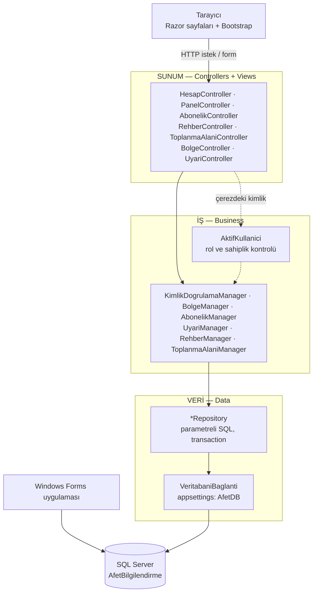

# Web Sitesi — Mimari ve Güvenlik Notu

## Katmanlı mimari

| Katman | Sorumluluk | Bilmediği şey |
|---|---|---|
| Sunum (`Controllers/`, `Views/`) | İsteği almak, sayfayı çizmek, iş hatalarını mesaja çevirmek | SQL, iş kuralı |
| İş (`Business/`) | Doğrulama, iş kuralları, rol ve sahiplik kontrolü | HTTP, HTML, SQL metni |
| Veri (`Data/`) | Parametreli SQL ile CRUD, transaction | Kullanıcı rolü, iş kuralı |
| Varlıklar (`Entities/`) | Tablolara karşılık gelen sınıflar | — |

Bağımlılıklar `Program.cs` içinde **bağımlılık enjeksiyonu** ile kurulur (repository ve manager'lar istek başına, bağlantı ve
giriş sayacı uygulama boyunca tek örnek).

## Güvenlik (Hafta 5)
| Konu | Uygulama |
|---|---|
| Parola | BCrypt (maliyet 11), her parolaya rastgele tuz. Düz metin saklanmaz. Kural: en az 8 karakter, büyük + küçük harf + rakam. |
| Oturum | ASP.NET Core çerez kimlik doğrulaması. Çerez şifreli ve `HttpOnly` (JavaScript okuyamaz), `SameSite=Lax`. 30 dk hareketsizlikte oturum düşer; panelin arka plan kontrolü süreyi uzatmaz. |
| Neden JWT değil? | Sunucu tarafında sayfa üreten bir MVC sitesi için çerez oturumu standarttır; JWT daha çok mobil/SPA istemcili API'lerde kullanılır. |
| Rol tabanlı erişim | `[Authorize]` (giriş zorunlu), `[Authorize(Policy = "Yonetici")]` (yönetim sayfaları) **ve** iş katmanında `YoneticiOlmali()`. Menü gizlemek tek başına güvenlik sayılmaz. |
| Sahiplik | Vatandaş yalnızca kendi aboneliğini değiştirebilir/silebilir (`AbonelikManager.SahiplikKontrol`). |
| Kaba kuvvet | Aynı kullanıcı adıyla 5 hatalı denemede 2 dk kilit (`GirisDenemeTakibi`). |
| Kullanıcı adı sızdırmama | "Kullanıcı yok" / "şifre yanlış" için aynı mesaj. |
| CSRF | Tüm POST formlarında anti-forgery anahtarı zorunlu (`AutoValidateAntiforgeryToken`). |
| XSS | Razor tüm çıktıları otomatik HTML-kodlar; kullanıcı metni ham HTML olarak basılmaz. |
| SQL Injection | Tüm sorgular parametreli. |
| Açık yönlendirme | Girişten sonra yalnızca site içi adreslere dönülür (`Url.IsLocalUrl`). |
| Rol yükseltme | Kayıt her zaman Vatandaş rolü verir; DB'de `CK_Kullanicilar_Rol` kısıtı vardır. |
| Gizli bilgi | Bağlantı cümlesi `appsettings.json`'da, Windows kimlik doğrulaması kullanır (parola yok). Gerçek sunucuda ortam değişkeni (`ConnectionStrings__AfetDB`) kullanılmalıdır. |

## Bilinen sınırlamalar
- Geliştirme ortamında site HTTP üzerinden çalışır; yayına alınırken HTTPS zorunlu yapılmalıdır (`UseHttpsRedirection`, `Cookie.SecurePolicy = Always`).
- Hatalı giriş kilidi bellekte tutulur; site yeniden başlarsa sıfırlanır.
- Pasif yapılan (AktifMi = 0) bir kullanıcının açık oturumu, çerez süresi dolana kadar devam eder.
