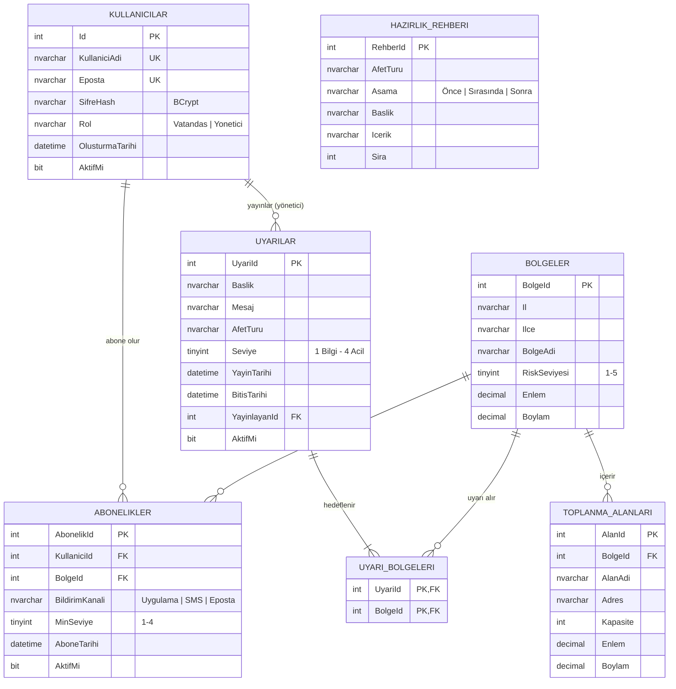

# Afet Erken Uyarı ve Bilgilendirme Sistemi
## ER Diyagramı (Hafta 3 – güncellendi Hafta 8)

## İlişkiler

| İlişki | Tür | Nasıl modellendi |
|---|---|---|
| Kullanıcı – Bölge (abonelik) | **N-N** | `Abonelikler` ara tablosu; `UNIQUE (KullaniciId, BolgeId)` aynı bölgeye iki kez abone olmayı engeller. Tercihler (kanal, min. seviye) ara tabloda tutulur. |
| Uyarı – Bölge (hedefleme) | **N-N** | `UyariBolgeleri` ara tablosu; birleşik PK `(UyariId, BolgeId)`. Bir uyarı birden çok bölgeye gidebilir. |
| Kullanıcı (yönetici) – Uyarı | 1-N | `Uyarilar.YayinlayanId` → `Kullanicilar.Id` |
| Bölge – Toplanma alanı | 1-N | `ToplanmaAlanlari.BolgeId` → `Bolgeler.BolgeId` |
| Hazırlık rehberi | bağımsız | Afet türüne göre gruplanır (bölgeden bağımsız içerik). |

## Normalizasyon notları
- **1NF:** Her sütun tek değer tutar; uyarının hedef bölgeleri virgüllü metin olarak değil, ayrı tabloda (`UyariBolgeleri`) tutulur.
- **2NF:** Ara tablolardaki tercih alanları (kanal, min. seviye) birleşik anahtarın tamamına bağlıdır.
- **3NF:** Bölge adı abonelik/uyarı tablolarında tekrar edilmez; yalnızca `BolgeId` tutulur.
  (`Bolgeler.BolgeAdi` = "İl / İlçe" görüntüleme kolaylığı için bilinçli olarak türetilmiş bir alandır; iş katmanı her kayıtta yeniden üretir.)

## Kısıtlar (özet)
- CHECK: `Rol`, `RiskSeviyesi (1-5)`, `Seviye (1-4)`, `MinSeviye (1-4)`, `AfetTuru`, `BildirimKanali`, `Kapasite > 0`, `BitisTarihi > YayinTarihi`, enlem/boylam aralıkları.
- UNIQUE: `KullaniciAdi`, `Eposta`, `(Il, Ilce)`, `(KullaniciId, BolgeId)`.
- FK + `ON DELETE CASCADE`: kullanıcı silinirse abonelikleri; uyarı silinirse hedef bölge kayıtları silinir.
- İndeksler: `Abonelikler.BolgeId`, `UyariBolgeleri.BolgeId`, `Uyarilar (AktifMi, YayinTarihi)`, `ToplanmaAlanlari.BolgeId`, `HazirlikRehberi (AfetTuru, Sira)` — "bölgedeki aboneler / kullanıcının uyarıları" sorgularını hızlandırmak için.
