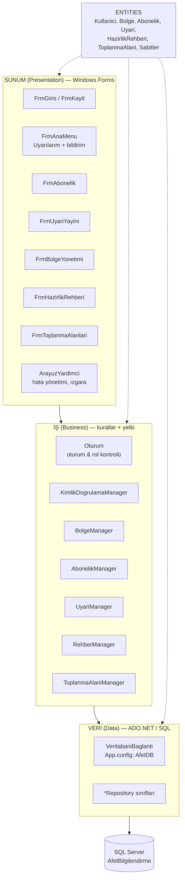

# Afet Erken Uyarı ve Bilgilendirme Sistemi
## Katmanlı Mimari Şeması

## Katmanların sorumlulukları

| Katman | Klasör | Sorumluluk | Bilmediği şey |
|---|---|---|---|
| Sunum | proje kökü (`Frm*.cs`, `ArayuzYardimci.cs`) | Kullanıcıdan veri almak, sonucu göstermek, hataları mesaj kutusuna çevirmek | SQL, iş kuralı |
| İş | `Business/` | Doğrulama, iş kuralları, **yetki kontrolü** (`Oturum.YoneticiGerekli()`), sahiplik kontrolü | Form/ekran, SQL metni |
| Veri | `Data/` | Parametreli SQL ile CRUD, transaction | İş kuralı, kullanıcı rolü |
| Varlıklar | `Entities/` | Tablolara karşılık gelen sade sınıflar ve sabit listeler | — |

## Neden katmanlı mimari?
- **Tek sorumluluk:** Uyarı yayınlama kuralı değişirse yalnızca `UyariManager` değişir; form ve SQL etkilenmez.
- **Güvenlik:** Yetki kontrolü arayüzde *ve* iş katmanında yapılır. Buton gizlense bile başka bir yoldan çağrılan
  `UyariManager.Yayinla()` vatandaş oturumunda `YetkisizErisimHatasi` fırlatır.
- **Test edilebilirlik:** İş katmanı form olmadan çağrılabilir (vize öncesi uçtan uca testler bu şekilde yapıldı).
- **Değiştirilebilirlik:** Hafta 9'da harita/bildirim API'si eklendiğinde yalnızca yeni bir servis sınıfı eklenecek.

## Örnek akış: "Yönetici uyarı yayınlar → vatandaş görür"
1. `FrmUyariYayini` formu `Uyari` nesnesini doldurur, `UyariManager.Yayinla()` çağırır.
2. `UyariManager` oturum + yönetici rolünü kontrol eder, başlık/mesaj/seviye/bölge/tarih kurallarını doğrular.
3. `UyariRepository.Ekle()` uyarıyı ve hedef bölgeleri **tek transaction** içinde yazar.
4. `AbonelikRepository.UyariAliciSayisi()` kaç aboneye ulaşacağını hesaplar, yöneticiye gösterilir.
5. Vatandaşın `FrmAnaMenu` ekranındaki zamanlayıcı (60 sn) `UyariManager.Uyarilarim()` ile yeni uyarıyı çeker,
   sesli uyarı verir ve uyarıyı seviyesine göre renklendirir.
